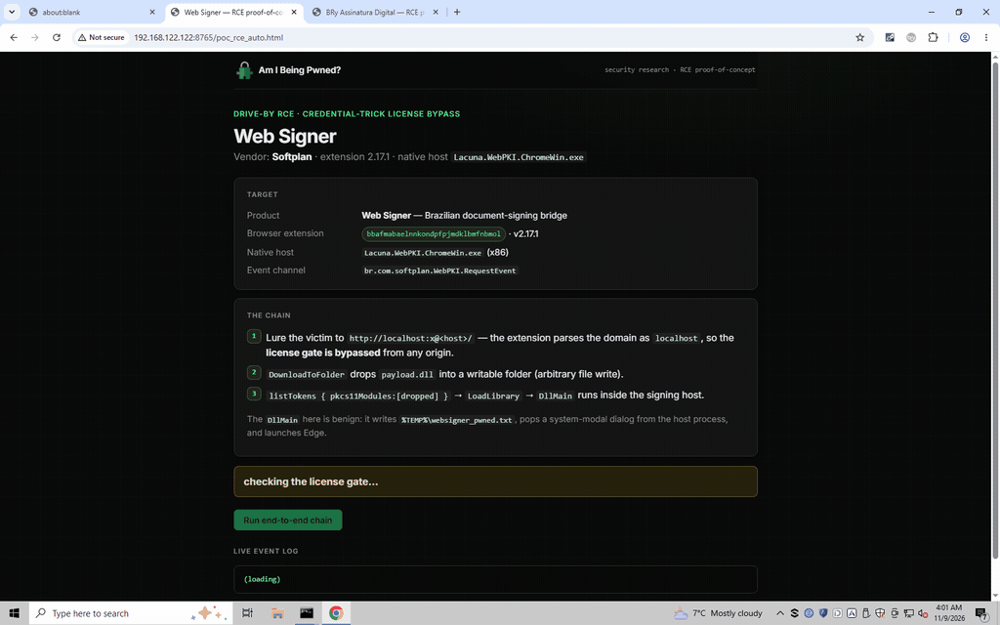
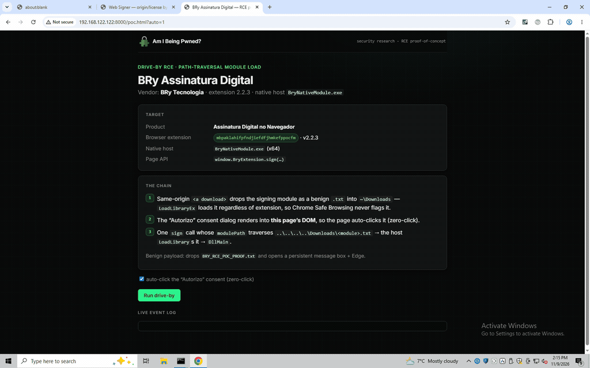
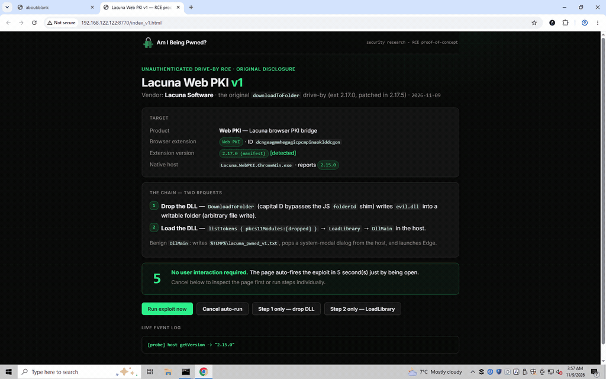
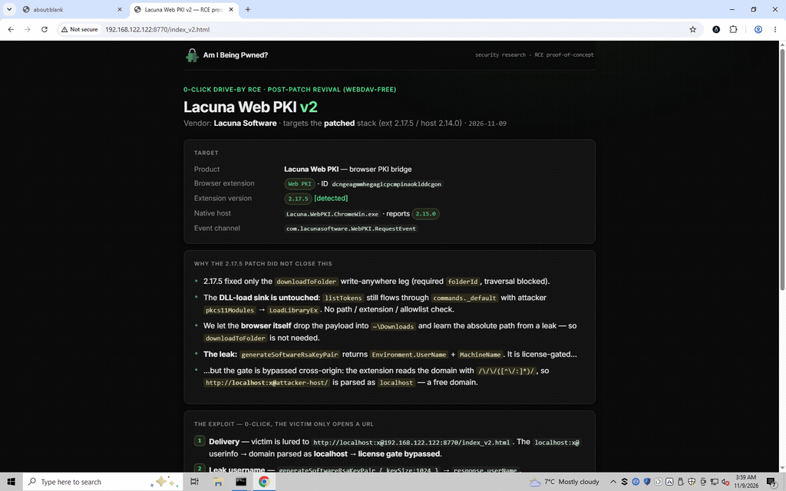
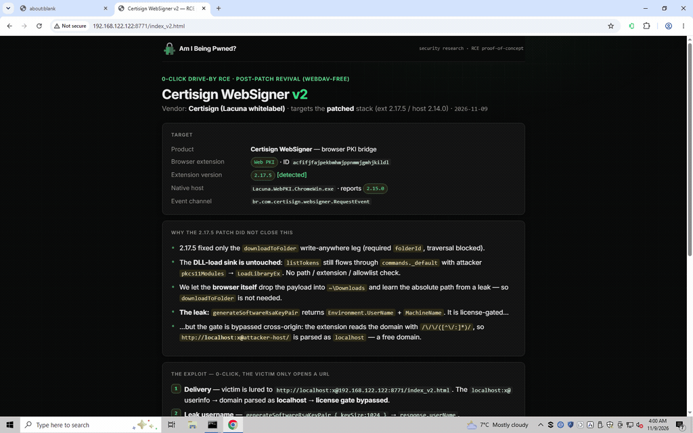
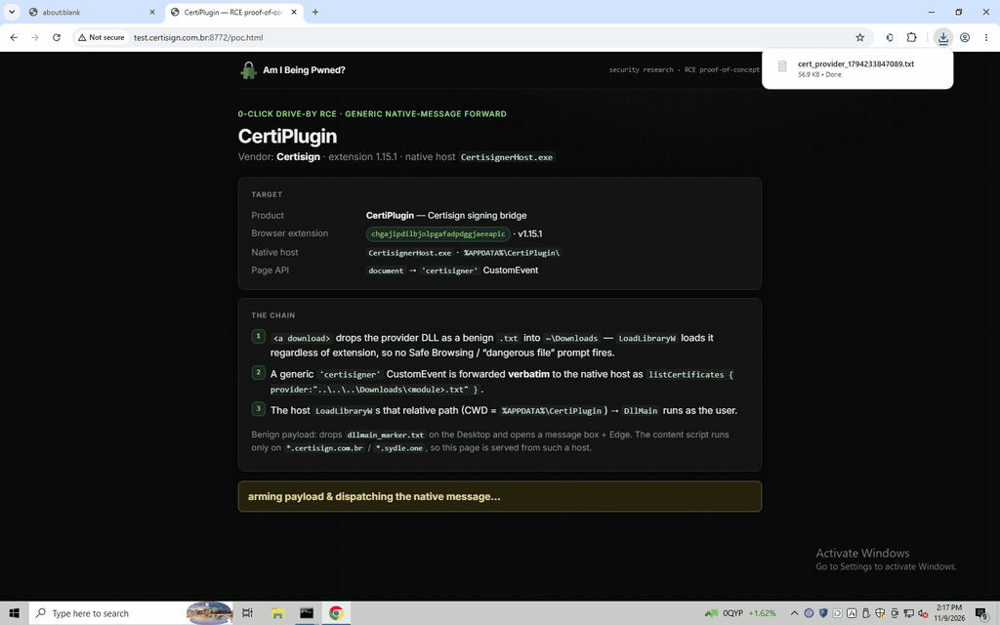

# Brazilian signing-extension RCE disclosures

Six responsibly-disclosed, now-patched **remote code execution** chains in major Brazilian
document-signing browser extensions. Each is a *drive-by*: visiting a single web page yields
code execution in the victim's user account, inside the extension's native-messaging host,
with little or no interaction.

All findings were reported to the vendors and fixed. Everything here uses a **benign**
payload (drops a marker file, shows a message box from inside the signing host, opens a video).
No weaponised binaries are included — the PoC payloads build from the C source provided. For
reproducibility, each target ships the **archived vulnerable extension** (unpacked, plus the
signed `.crx` where we have it); CertiPlugin additionally ships its **native-host installer**
(`Setup_CertiPlugin.exe`). The other native hosts must be obtained from each vendor.

## The six

| # | Target | Vendor | Ext ID · version | Native host | Chain | Demo |
|---|--------|--------|------------------|-------------|-------|------|
| 1 | [Web Signer](targets/01-web-signer/) | Softplan | `bbafma…` · 2.17.1 | `Lacuna.WebPKI.ChromeWin.exe` | license bypass → `DownloadToFolder` → `listTokens`→`LoadLibrary` | [gif](gifs/websigner_rce.gif) |
| 2 | [BRy Assinatura](targets/02-bry/) | BRy Tecnologia | `mbpakla…` · 2.2.3 | `BryNativeModule.exe` | `<a download>` + `sign()` `modulePath` traversal | [gif](gifs/bry_rce.gif) |
| 3 | [Lacuna Web PKI v1](targets/03-lacuna-webpki-v1/) | Lacuna | `dcngeag…` · 2.17.0 | `Lacuna.WebPKI.ChromeWin.exe` | `DownloadToFolder` case-bypass → `listTokens`→`LoadLibrary` | [gif](gifs/webpki_v1_rce.gif) |
| 4 | [Lacuna Web PKI v2](targets/04-lacuna-webpki-v2/) | Lacuna | `dcngeag…` · 2.17.5 | `Lacuna.WebPKI.ChromeWin.exe` | username leak → browser drop → `listTokens`→`LoadLibraryEx` | [gif](gifs/webpki_v2_rce.gif) |
| 5 | [Certisign WebSigner](targets/05-certisign-websigner/) | Certisign (Lacuna whitelabel) | `acfifj…` · 2.17.5 | `Lacuna.WebPKI.ChromeWin.exe` | same v2 chain, different channel | [gif](gifs/certisign_rce.gif) |
| 6 | [CertiPlugin](targets/06-certiplugin/) | Certisign | `chgajip…` · 1.15.1 | `CertisignerHost.exe` | generic `certisigner` event → `listCertificates` provider traversal → `LoadLibraryW` | [gif](gifs/certiplugin_rce.gif) |

## The common shape

Every one of these extensions bridges a web page to a **native-messaging host** that ends up
calling `LoadLibrary`/`LoadLibraryEx`/`LoadLibraryW` on an **attacker-influenced path** — either
a PKCS#11 "module", a certificate "provider", or a signing "modulePath" — with no signature,
extension or allowlist check. `DllMain` runs before the intended operation fails. The browser
(or an extension `downloadToFolder`) provides the file write; a license gate, where present, is
bypassed by luring the victim to `http://localhost:x@<attacker-host>/` so the extension's naïve
domain regex parses `localhost`.

The three Lacuna-engine products (Web Signer, Lacuna Web PKI, Certisign WebSigner) share the
**identical** `Lacuna.WebPKI.ChromeWin.exe` binary — only the extension ID, native-host name and
event-channel names differ.

## Layout

```
gifs/                         all six demo recordings
targets/<n>-<name>/
    README.md                 per-target advisory (target, host, installer, extension, chain)
    poc/<page>.html           the drive-by page (Am I Being Pwned? design language)
    payload/<src>.c           benign PoC payload — build it yourself
    extension/                archived vulnerable extension (unpacked)
    *.crx                     signed extension package (where available)
    native-host/              native-host installer (CertiPlugin only)
```

## Demos

Each GIF shows the same arc: the branded PoC page → Microsoft Edge opens the benign payload's
video → a message box, rendered **by the signing host process**, proving arbitrary code is
running as the user.

The recordings are made on a lab VM with **Chrome Safe Browsing enabled** — no browser security
control is disabled to make the demo seamless. The chains that drop their module through the
browser deliver it as a benign `.txt`; `LoadLibrary`/`LoadLibraryEx`/`LoadLibraryW` load a DLL
regardless of its file extension, so Safe Browsing has nothing to flag. The native-host
`DownloadToFolder` chains (Web Signer, Web PKI v1) write the file through the host itself and
never touch the browser download path at all.

### Web Signer (Softplan)


### BRy Assinatura


### Lacuna Web PKI v1


### Lacuna Web PKI v2


### Certisign WebSigner


### CertiPlugin


## Responsible use

For defenders, vendors and researchers. These issues are patched; run the PoCs only against
software you own on an isolated VM. Do not use them against anyone else.
