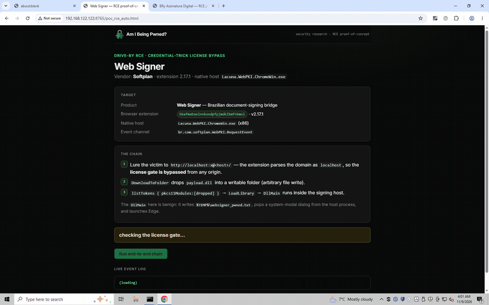

# Web Signer — drive-by RCE via PKCS#11 module-path injection

**Status:** responsibly disclosed & patched · benign proof-of-concept for a security-research write-up.



*The demo page → Microsoft Edge opens the (benign) payload's video → a message box proves code is running inside the signing host.*

## Target

| | |
|---|---|
| Vendor | Softplan |
| Product | Web Signer (Brazilian document-signing bridge) |
| Browser extension | `bbafmabaelnnkondpfpjmdklbmfnbmol` · v2.17.1 |
| Extension source | Chrome Web Store (archived CRX) |
| Native host | `Lacuna.WebPKI.ChromeWin.exe` 2.15.0 (x86) |
| Native-host name | `br.com.softplan.webpki`  (allowed_origins: `chrome-extension://bbafmabaelnnkondpfpjmdklbmfnbmol/`) |
| Installer | `WebSignerSetup_en-US.msi` |
| Install path | `%LOCALAPPDATA%\Softplan Sistemas\Web Signer\` |
| Page channel / API | `br.com.softplan.WebPKI.RequestEvent` |
| Patched in | 2.18.x |

## The vulnerability

Web Signer embeds the Lacuna Web PKI engine. The native host's `listTokens` command `LoadLibrary`s every path in the attacker-supplied `pkcs11Modules` list with no path/signature/allowlist check — `DllMain` runs before the PKCS#11 init error is observed. A licensing gate is the only barrier, and it is bypassable cross-origin.

## The chain

1. Lure the victim to `http://localhost:x@<attacker-host>/` — the extension extracts the domain with a regex that stops at the first `:`, so it parses `localhost` (a free domain) and the **license gate is bypassed** from any origin.
2. `DownloadToFolder` writes `payload.dll` into a writable folder (arbitrary file write; the 2.15.0 host forces a `.bin` extension, which `LoadLibraryEx` ignores).
3. `listTokens { pkcs11Modules:[dropped] }` → `LoadLibrary` → `DllMain` executes inside the signing host as the user.

The marker written on success: `%TEMP%\websigner_pwned.txt`.

## Files

- `poc/ws_poc_rce_auto.html` — the drive-by page, styled in the Am I Being Pwned? design language. Auto-fires for the demo; buttons step through it manually.
- `payload/payload_ws.c`

## Building the benign payload

No compiled binary is shipped. Build it yourself from the C source (32-bit for the x86 Lacuna hosts, x64 for BRy):

```
i686-w64-mingw32-gcc -shared -m32 -O2 -o payload.dll payload_ws.c -luser32 -lkernel32
```

The payload is benign: it drops a marker file, pops a labelled message box from inside the signing host process, and launches Microsoft Edge to a video. Swap in your own `DllMain` to verify real execution.

## Reproducing the demo

1. Install the product (extension + native host) on a throwaway VM.
2. Serve `poc/` over HTTP from a non-localhost origin (the credential-trick chains open it via `http://localhost:x@<host>/…`).
3. Open the page. The chain fires on load.
