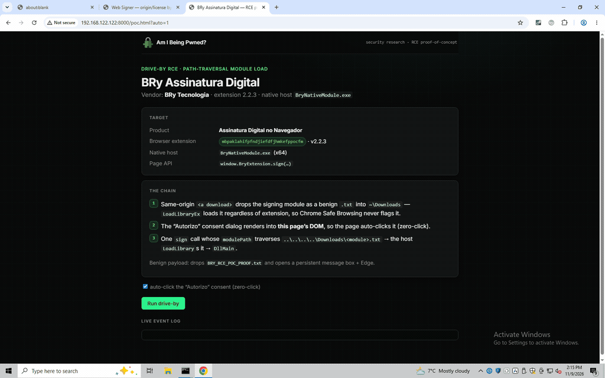

# BRy Assinatura Digital — drive-by RCE via sign() module-path traversal

**Status:** responsibly disclosed & patched · benign proof-of-concept for a security-research write-up.



*The demo page → Microsoft Edge opens the (benign) payload's video → a message box proves code is running inside the signing host.*

## Target

| | |
|---|---|
| Vendor | BRy Tecnologia |
| Product | Assinatura Digital no Navegador |
| Browser extension | `mbpaklahifpfndjiefdfjhmkefppocfm` · v2.2.3 |
| Extension source | Chrome Web Store (archived CRX) |
| Native host | `BryNativeModule.exe` (x64) |
| Native-host name | `com.bry.extension`  (allowed_origins: `chrome-extension://mbpaklahifpfndjiefdfjhmkefppocfm/`) |
| Installer | `BRy WebExtension installer` |
| Install path | `%LOCALAPPDATA%\Bry Tecnologia\Bry WebExtension\` |
| Page channel / API | `window.BryExtension.sign(...)` |
| Patched in | 2.3.0 |

## The vulnerability

The extension forwards a page-supplied `sign` request to the native host. The request's `modulePath` (carried inside a JSON `certId`) is loaded via `LoadLibraryExA` in the PKCS#11 module constructor **before** the bogus key is validated. The host's working directory is its fixed install dir, so a relative traversal is username-independent. The `Autorizo` consent dialog is a SweetAlert rendered into the attacker page's own DOM, so the page auto-dismisses it (zero-click).

## The chain

1. A same-origin `<a download>` drops the signing module as a benign `.txt` (a unique `br_sign_module_<ts>.txt`) into `~\Downloads`. `LoadLibraryEx` loads a DLL regardless of its file extension, and Chrome does not flag a `.txt` download — so this lands cleanly with **Safe Browsing enabled** (no browser security control is disabled).
2. A `MutationObserver` auto-clicks the `Autorizo` consent as soon as it renders into the page DOM (zero-click).
3. One `sign` call with `modulePath = ..\..\..\..\Downloads\<module>.txt` → the host `LoadLibrary`s it → `DllMain`. A standalone `brymsg.exe` helper is spawned so the proof dialog survives the host tearing down.

The marker written on success: `%TEMP%\BRY_RCE_POC_PROOF.txt (and Desktop)`.

## Files

- `poc/bry_poc.html` — the drive-by page, styled in the Am I Being Pwned? design language. Auto-fires for the demo; buttons step through it manually.
- `payload/poc_bry.c`
- `payload/brymsg.c`

## Building the benign payload

No compiled binary is shipped. Build it yourself from the C source (32-bit for the x86 Lacuna hosts, x64 for BRy):

```
x86_64-w64-mingw32-gcc -shared -O2 -o evil.dll poc_bry.c -luser32 ; x86_64-w64-mingw32-gcc -O2 -o brymsg.exe brymsg.c -luser32 -mwindows
```

The payload is benign: it drops a marker file, pops a labelled message box from inside the signing host process, and launches Microsoft Edge to a video. Swap in your own `DllMain` to verify real execution.

## Reproducing the demo

1. Install the product (extension + native host) on a throwaway VM.
2. Serve `poc/` over HTTP from a non-localhost origin (the credential-trick chains open it via `http://localhost:x@<host>/…`).
3. Open the page. The chain fires on load.
