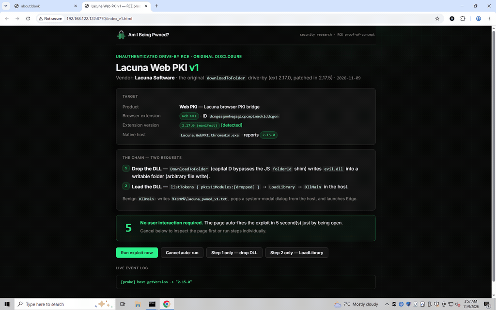

# Lacuna Web PKI v1 — unauthenticated drive-by RCE (original disclosure)

**Status:** responsibly disclosed & patched · benign proof-of-concept for a security-research write-up.



*The demo page → Microsoft Edge opens the (benign) payload's video → a message box proves code is running inside the signing host.*

## Target

| | |
|---|---|
| Vendor | Lacuna Software |
| Product | Web PKI (browser PKI bridge) |
| Browser extension | `dcngeagmmhegagicpcmpinaoklddcgon` · v2.17.0 |
| Extension source | crx4chrome archived CRX (CWS serves latest only) |
| Native host | `Lacuna.WebPKI.ChromeWin.exe` 2.14.0 (advisory) / 2.15.0 (on test box) |
| Native-host name | `com.lacunasoftware.webpki`  (allowed_origins: `chrome-extension://dcngeagmmhegagicpcmpinaoklddcgon/`) |
| Installer | `Web PKI installer (or Web Signer's bundled Lacuna host)` |
| Install path | `%LOCALAPPDATA%\Lacuna Software\Web PKI\` |
| Page channel / API | `com.lacunasoftware.WebPKI.RequestEvent` |
| Patched in | 2.17.5 |

## The vulnerability

Two flaws compose into one-page-load RCE. (1) `listTokens` `LoadLibrary`s attacker `pkcs11Modules` paths with no validation. (2) The JS dispatcher's command lookup is case-sensitive while the native dispatcher is case-insensitive, so `DownloadToFolder` (capital D) misses the JS shim that would require a server-resolved `folderId`, falls through `commands._default`, and reaches the native write-anywhere primitive. On the genuine 2.14.0 host neither command is license-gated, so any origin works.

> **Note:** On a license-gated host build (e.g. 2.15.0) the same `localhost:x@` credential-trick as v2 is used to satisfy the gate; the distinctive part-1 element — `DownloadToFolder`'s arbitrary-write drop, unpatched in ext 2.17.0 — is genuine.

## The chain

1. **Drop** — `DownloadToFolder` (capital-D case bypass) writes `evil.dll` into a writable folder (arbitrary file write).
2. **Load** — `listTokens { pkcs11Modules:[dropped] }` → `LoadLibrary` → `DllMain` in the host.

The marker written on success: `%TEMP%\lacuna_pwned_v1.txt`.

## Files

- `poc/webpki_index_v1.html` — the drive-by page, styled in the Am I Being Pwned? design language. Auto-fires for the demo; buttons step through it manually.
- `payload/evil_v1.c`

## Building the benign payload

No compiled binary is shipped. Build it yourself from the C source (32-bit for the x86 Lacuna hosts, x64 for BRy):

```
i686-w64-mingw32-gcc -shared -m32 -O2 -o evil.dll evil_v1.c -luser32 -lkernel32 -lshell32
```

The payload is benign: it drops a marker file, pops a labelled message box from inside the signing host process, and launches Microsoft Edge to a video. Swap in your own `DllMain` to verify real execution.

## Reproducing the demo

1. Install the product (extension + native host) on a throwaway VM.
2. Serve `poc/` over HTTP from a non-localhost origin (the credential-trick chains open it via `http://localhost:x@<host>/…`).
3. Open the page. The chain fires on load.
