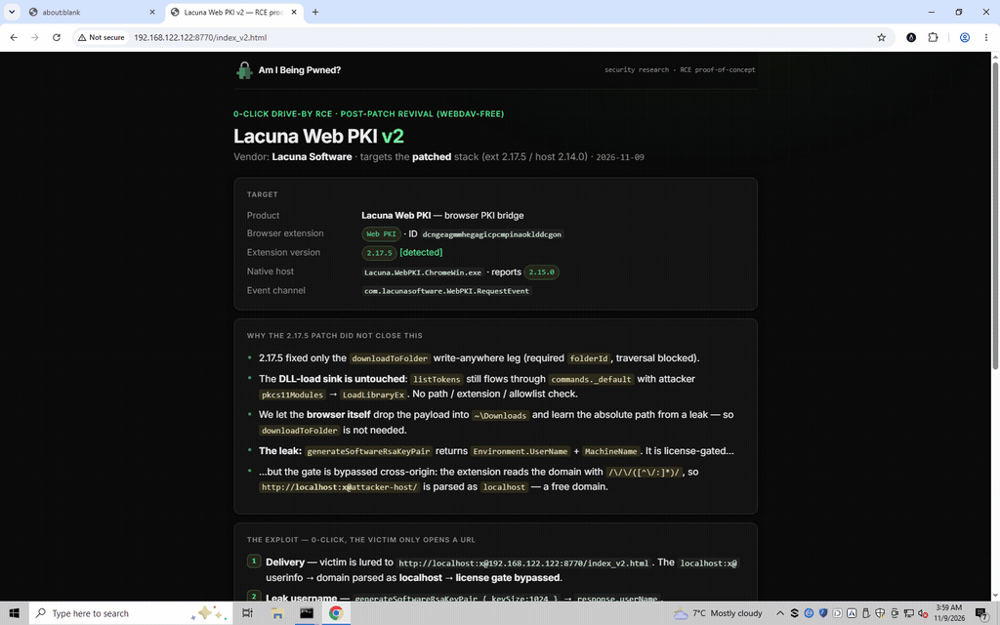

# Lacuna Web PKI v2 — 0-click RCE revival against the 2.17.5 patch

**Status:** responsibly disclosed & patched · benign proof-of-concept for a security-research write-up.



*The demo page → Microsoft Edge opens the (benign) payload's video → a message box proves code is running inside the signing host.*

## Target

| | |
|---|---|
| Vendor | Lacuna Software |
| Product | Web PKI (browser PKI bridge) |
| Browser extension | `dcngeagmmhegagicpcmpinaoklddcgon` · v2.17.5 |
| Extension source | Chrome Web Store (archived CRX) |
| Native host | `Lacuna.WebPKI.ChromeWin.exe` 2.14.0 / 2.15.0 |
| Native-host name | `com.lacunasoftware.webpki`  (allowed_origins: `chrome-extension://dcngeagmmhegagicpcmpinaoklddcgon/`) |
| Installer | `Web PKI installer (or Web Signer's bundled Lacuna host)` |
| Install path | `%LOCALAPPDATA%\Lacuna Software\Web PKI\` |
| Page channel / API | `com.lacunasoftware.WebPKI.RequestEvent` |
| Patched in | (sink still open as of writing; re-disclosed) |

## The vulnerability

2.17.5 fixed only the `downloadToFolder` write-anywhere leg (required `folderId`, blocked traversal). The DLL-load sink is untouched: `listTokens` still flows through `commands._default` to `LoadLibraryEx` with no validation. The payload is dropped by the **browser itself** into `~\Downloads` (no `downloadToFolder` needed), and its absolute path is learned from a username leak.

## The chain

1. **Delivery** — victim opens `http://localhost:x@<attacker-host>/`; the domain parses as `localhost` → **license gate bypassed**.
2. **Leak** — `generateSoftwareRsaKeyPair { keySize:1024 }` returns `Environment.UserName` (now ungated) → absolute `~\Downloads` path.
3. **Drop** — `fetch()` the payload and save it as `~\Downloads\evil_v2_<ts>.txt` via `<a download>` (browser download, no prompt). `LoadLibraryEx` ignores the `.txt` extension.
4. **Load** — `listTokens { pkcs11Modules:[absolute path] }` → `LoadLibraryEx` → `DllMain`.

The marker written on success: `%TEMP%\lacuna_pwned_v2.txt`.

## Files

- `poc/webpki_index_v2.html` — the drive-by page, styled in the Am I Being Pwned? design language. Auto-fires for the demo; buttons step through it manually.
- `payload/evil_v2.c`

## Building the benign payload

No compiled binary is shipped. Build it yourself from the C source (32-bit for the x86 Lacuna hosts, x64 for BRy):

```
i686-w64-mingw32-gcc -shared -m32 -O2 -o evil_v2.dll evil_v2.c -luser32 -lkernel32 -lshell32
```

The payload is benign: it drops a marker file, pops a labelled message box from inside the signing host process, and launches Microsoft Edge to a video. Swap in your own `DllMain` to verify real execution.

## Reproducing the demo

1. Install the product (extension + native host) on a throwaway VM.
2. Serve `poc/` over HTTP from a non-localhost origin (the credential-trick chains open it via `http://localhost:x@<host>/…`).
3. Open the page. The chain fires on load.
