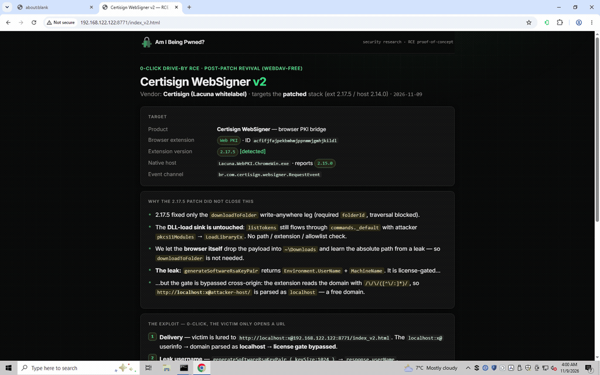

# Certisign WebSigner — 0-click RCE (Lacuna whitelabel)

**Status:** responsibly disclosed & patched · benign proof-of-concept for a security-research write-up.



*The demo page → Microsoft Edge opens the (benign) payload's video → a message box proves code is running inside the signing host.*

## Target

| | |
|---|---|
| Vendor | Certisign (Lacuna Web PKI whitelabel) |
| Product | Certisign WebSigner |
| Browser extension | `acfifjfajpekbmhmjppnmmjgmhjkildl` · v2.17.5 |
| Extension source | Chrome Web Store (archived CRX) |
| Native host | `Lacuna.WebPKI.ChromeWin.exe` 2.14.0 / 2.15.0 |
| Native-host name | `br.com.certisign.websigner`  (allowed_origins: `chrome-extension://acfifjfajpekbmhmjppnmmjgmhjkildl/`) |
| Installer | `Certisign WebSigner installer (bundles the Lacuna host)` |
| Install path | `%LOCALAPPDATA%\Certisign\Web PKI\` |
| Page channel / API | `br.com.certisign.websigner.RequestEvent` |
| Patched in | (tracks the Lacuna engine) |

## The vulnerability

Certisign WebSigner is a whitelabel of the Lacuna Web PKI engine and shares the identical native host binary. Only the extension ID, native-host name and event-channel names differ. The v2 chain applies verbatim.

## The chain

1. Same 0-click v2 chain as Lacuna Web PKI v2, over the `br.com.certisign.websigner.RequestEvent` channel: credential-trick license bypass → username leak → browser `<a download>` → `listTokens` → `LoadLibraryEx`.

The marker written on success: `%TEMP%\certisign_pwned.txt`.

## Files

- `poc/certisign_index_v2.html` — the drive-by page, styled in the Am I Being Pwned? design language. Auto-fires for the demo; buttons step through it manually.
- `payload/evil_cs.c`

## Building the benign payload

No compiled binary is shipped. Build it yourself from the C source (32-bit for the x86 Lacuna hosts, x64 for BRy):

```
i686-w64-mingw32-gcc -shared -m32 -O2 -o evil_v2.dll evil_cs.c -luser32 -lkernel32 -lshell32
```

The payload is benign: it drops a marker file, pops a labelled message box from inside the signing host process, and launches Microsoft Edge to a video. Swap in your own `DllMain` to verify real execution.

## Reproducing the demo

1. Install the product (extension + native host) on a throwaway VM.
2. Serve `poc/` over HTTP from a non-localhost origin (the credential-trick chains open it via `http://localhost:x@<host>/…`).
3. Open the page. The chain fires on load.
