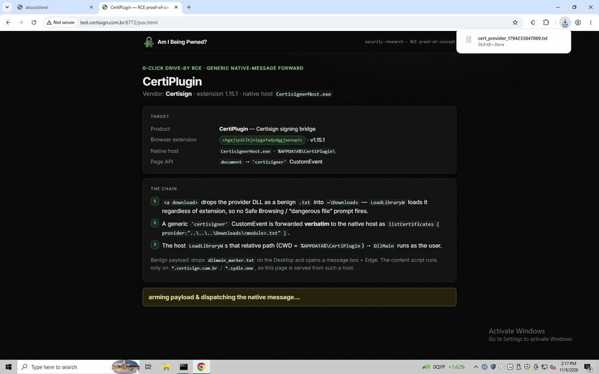

# CertiPlugin — 0-click RCE via generic native-message forwarding

**Status:** responsibly disclosed & patched · benign proof-of-concept for a security-research write-up.



*The demo page → Microsoft Edge opens the (benign) payload's video → a message box proves code is running inside the signing host.*

## Target

| | |
|---|---|
| Vendor | Certisign |
| Product | CertiPlugin |
| Browser extension | `chgajipdilbjolpgafadpdggjaeeapic` · v1.15.1 |
| Extension source | Chrome Web Store (archived CRX) |
| Native host | `CertisignerHost.exe` 1.2.0.1 |
| Native-host name | `br.com.certisign.certisigner`  (allowed_origins: `chrome-extension://chgajipdilbjolpgafadpdggjaeeapic/`) |
| Installer | `Setup_CertiPlugin.exe (Inno Setup: /VERYSILENT /SUPPRESSMSGBOXES /NORESTART)` |
| Install path | `%APPDATA%\CertiPlugin\` |
| Page channel / API | `document → 'certisigner' CustomEvent` |
| Patched in | responsibly disclosed |

## The vulnerability

The content script (injected on `*.certisign.com.br`, `*.certintra.com.br`, `*.sydle.one`) forwards any page `'certisigner'` CustomEvent verbatim to the native host. The host's `listCertificates` action calls `LoadLibraryW` on the attacker-supplied `provider` path. The host CWD is `%APPDATA%\CertiPlugin`, so a relative traversal is username-independent; `LoadLibraryW` ignores the file extension.

## The chain

1. `<a download>` drops the provider DLL as a benign `.txt` (a unique `cert_provider_<ts>.txt`) into `~\Downloads`. `LoadLibraryW` loads it regardless of extension and Chrome does not flag a `.txt`, so nothing fires with **Safe Browsing enabled**.
2. A generic `'certisigner'` CustomEvent is forwarded verbatim as `listCertificates { repository:'HARDWARE', provider:'..\..\..\Downloads\<module>.txt' }`.
3. The host `LoadLibraryW`s that relative path → `DllMain` runs as the user.

The marker written on success: `%USERPROFILE%\Desktop\dllmain_marker.txt`.

## Files

- `poc/certiplugin_poc.html` — the drive-by page, styled in the Am I Being Pwned? design language. Auto-fires for the demo; buttons step through it manually.
- `payload/marker.c`

## Building the benign payload

No compiled binary is shipped. Build it yourself from the C source (32-bit for the x86 Lacuna hosts, x64 for BRy):

```
i686-w64-mingw32-gcc -shared -O2 -o cert_icon.png marker.c -luser32   (32-bit; the server offers these bytes, the page saves them as a benign .txt that LoadLibraryW loads regardless of extension)
```

The payload is benign: it drops a marker file, pops a labelled message box from inside the signing host process, and launches Microsoft Edge to a video. Swap in your own `DllMain` to verify real execution.

## Reproducing the demo

1. Install the product (extension + native host) on a throwaway VM.
2. Serve `poc/` over HTTP from a non-localhost origin (the credential-trick chains open it via `http://localhost:x@<host>/…`).
3. Open the page. The chain fires on load.
